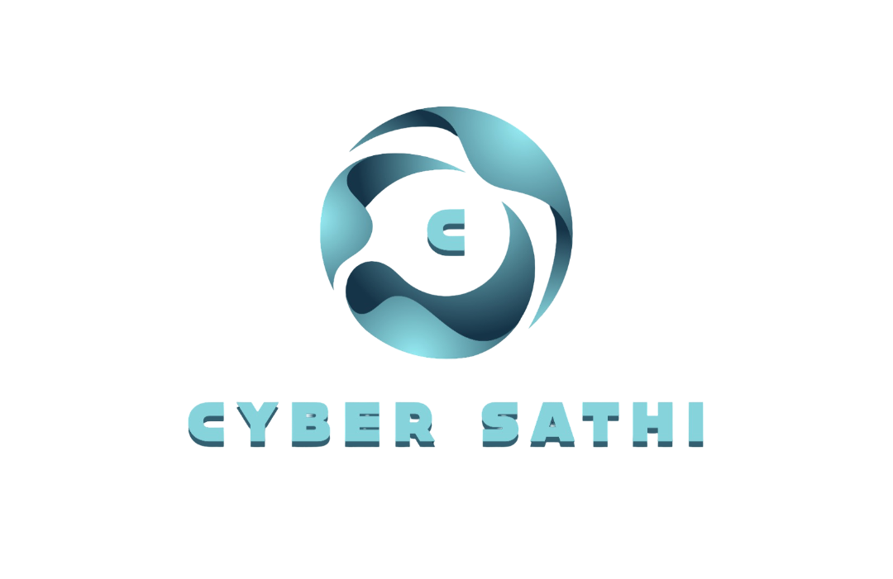

<div align="center">

#  Cyber Sathi

---


<br/>

[Purpose](#purpose--aim) · [Features](#features) · [Quickstart](#quickstart) · [Tech Stack](#tech-stack) · [Data Notice](#data--third-party-notice) · [Security](#security)

<br/>

*Bilingual (English/Hindi) voice-first companion for reporting cyber fraud in India. A testing/demonstration project showing how a victim can move from reporting to action.*

</div>

---

## Purpose / Aim

Cyber Sathi demonstrates how a victim of cyber fraud can move from reporting to action. It is a **demo/testing project** that shows the ideal flow:

1. Victim opens the app and describes the fraud (text or voice).
2. The assistant ("Sathi") gathers details — OTP requests, phishing links, UPI scams, etc.
3. Evidence can be uploaded (screenshots, chat logs) and extracted automatically.
4. A case record is created and can be tracked through status transitions.
5. A report is generated that can be shared with the cybercrime portal or bank.

It is **not** a production emergency service and does not directly file FIRs or connect to police systems.

---

## What it does not

- It is **not** connected to the National Cyber Crime Reporting Portal (NCRP) or any police API.
- It does **not** file FIRs, lodge complaints, or guarantee legal action.
- It does **not** recover stolen money or reverse fraudulent transactions.
- It is a **demonstration flow**, not a live incident-response system.

---

## Features

- **Bilingual chat:** English and Hindi (Hinglish) responses matched to the user's message language.
- **Voice-first intake:** Bland AI voice agent for spoken reporting; typed chat as fallback.
- **Evidence upload & extraction:** Screenshots/chat logs uploaded to Supabase Storage; values extracted in the background (candidates to review, not verified facts).
- **Case tracking:** Create, update, and transition case statuses (e.g. `PROCESSING` → `ARCHIVED`).
- **Report generation:** Compile extracted data into a report for sharing with banks or portals.
- **Free tier infrastructure:** Voice agent chat and processing run on free-tier third-party services (Bland AI, Supabase, Render, Cloudflare Pages). User data passes through these providers' servers — review their retention and privacy policies before sharing sensitive information.

---

## Why use this

- **Ease of use:** No login wall to start reporting; voice or text in your preferred language.
- **Clear flow:** Shows victims exactly what information to gather and in what order.
- **Open structure:** Frontend + backend separated; easy to extend with real portal integrations.
- **Safe defaults:** Never asks for OTPs, PINs, passwords, CVV, full card numbers, or government-ID numbers. Never share those.

---

## Quickstart

### Prerequisites
- Node.js 22+ and pnpm 10.34.3
- Docker Engine 27.x (Compose V2) — for local Postgres/Redis/MinIO

### Run locally

```bash
# 1. Install dependencies
pnpm install

# 2. Copy env files and fill in values
cp .env.example .env
cp apps/api/.env.example apps/api/.env

# 3. Start local infrastructure (Postgres, Redis, MinIO)
pnpm compose:up

# 4. Set up database
pnpm --filter @cybersathi/api prisma:deploy
pnpm --filter @cybersathi/api prisma:seed

# 5. Start backend (port 3000)
pnpm start:dev

# 6. Start frontend (port 8443)
pnpm dev
```

- **Frontend:** http://localhost:8443
- **API:** http://localhost:3000
- **Health:** http://localhost:3000/health
- **Swagger docs:** http://localhost:3000/api/docs

---

## Data & Third-Party Notice

Cyber Sathi uses **free-tier third-party infrastructure** for voice agent chat and processing:

- **Bland AI** — voice calls and voice chat
- **Supabase** — database, auth, and storage
- **Render** — API hosting
- **Cloudflare Pages** — frontend hosting

Because of this, **user data (case details, transcripts, uploaded evidence) passes through these providers' servers.** This project cannot guarantee provider retention, deletion, or training policies. Do not share OTPs, PINs, passwords, CVV, full card numbers, or government-ID numbers.

This is a **testing/demonstration project** — not for production use with real victim data without reviewing provider terms.

---

## Tech Stack

| Layer | Technology |
| --- | --- |
| Frontend | React 19 + Vite + Tailwind CSS v4 |
| Backend | NestJS + TypeScript |
| Database | PostgreSQL + Prisma ORM |
| Jobs/Cache | Redis + BullMQ |
| Storage | MinIO (local) / Supabase Storage (cloud) |
| Voice | Bland AI |
| AI/LLM | Gemini, Groq, OpenAI |
| Auth | Supabase Auth (Phone/Email OTP) |

---

## Branching & Commits

**Trunk-based:** `main` is always releasable. Work on short-lived `feat/<topic>` or `fix/<topic>` branches.

**Conventional Commits:** `type(scope): summary`  
Example: `feat(cases): add status transition audit entries`

---

## Security

Never commit `.env` files, Supabase service-role keys, or API keys. PII must never appear in public report content. See `docs/` for tool contracts and integration notes.
